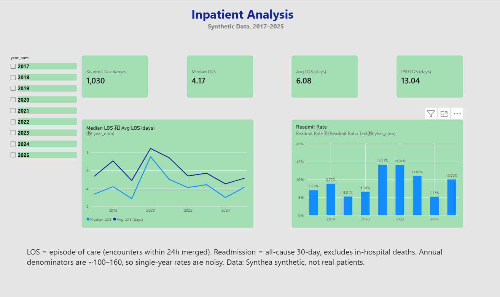
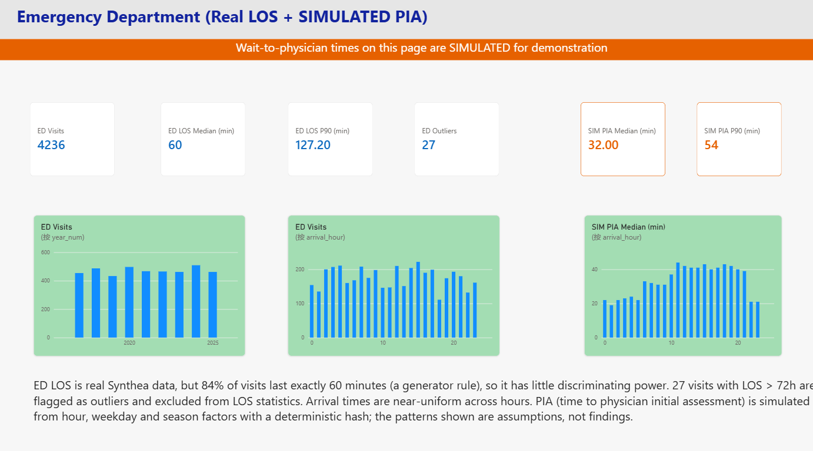
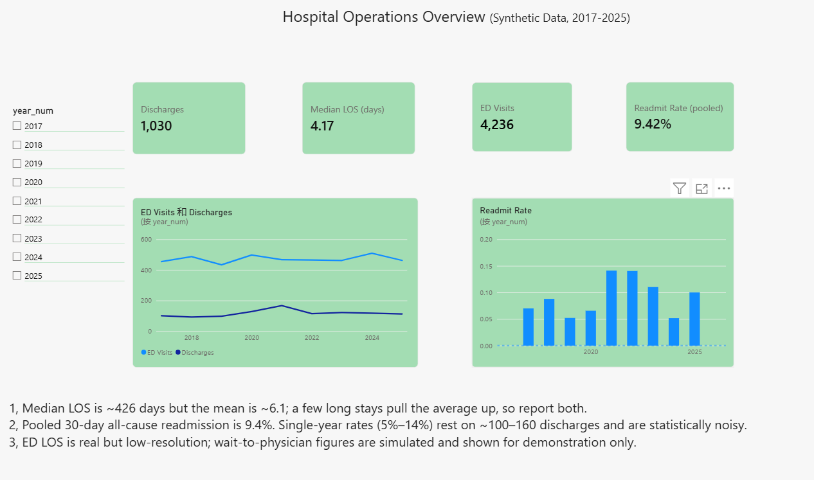
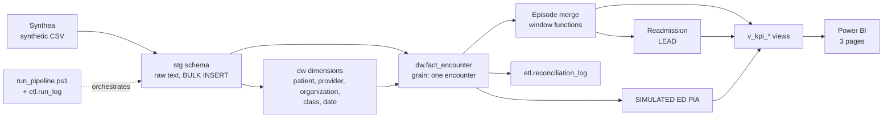

# Hospital Operations Analytics (SQL Server + Power BI)

An end-to-end, reproducible analytics pipeline that turns synthetic hospital records into a star-schema
warehouse and a three-page Power BI report covering **inpatient length of stay (LOS)**, **30-day readmission**
and **emergency department (ED) activity**.

> **All data is synthetic** (generated with [Synthea](https://github.com/synthetichealth/synthea)). Nothing here
> describes a real hospital or real patients. Wait-to-physician times are **simulated** and always labelled as such.

## Why this project

Hospital decision-support work is mostly: extract data from operational systems, define metrics that
stakeholders agree on, make the numbers reproducible and auditable, and present them clearly. This project
practises that whole loop: SQL modelling, advanced SQL, ETL automation, data quality checks, KPI definitions
and dashboards.

## Screenshots

| Inpatient | Emergency (real + SIMULATED) | Executive overview |
|---|---|---|
|  |  |  |

## Architecture



Three layers: `stg` (raw, untyped, as received), `dw` (typed, cleaned, modelled), `etl` (run log and
reconciliation results). Power BI reads only the `v_kpi_*` views, so each metric's scope and exclusions are
defined in exactly one place.

## Key results (2017-2025, synthetic data)

| Metric | Result |
|---|---|
| Inpatient episodes | 1,050 (from 2,942 raw inpatient encounters across all years merged to 2,761 episodes) |
| Median LOS / mean LOS | about 4.2 / 6.1 days (right-skewed, so both are reported) |
| 30-day all-cause readmission (pooled) | 97 / 1,030 = 9.4% |
| ED visits | 4,236 (27 flagged as outliers, > 72 h) |

## Technical highlights

- **Gaps-and-islands episode merge.** Source data splits one stay into several encounters (ICU transfer,
  overlaps). Window functions (`MAX() OVER` with a running frame, `SUM() OVER` over a new-episode flag)
  merge encounters within 24 h of the latest discharge. Raw admissions were overstated by about 7%.
- **Readmission with `LEAD`**, excluding in-hospital deaths, attributed to the index discharge.
- **Star schema** with surrogate keys, an Unknown (-1) member in every dimension, and indexes for the
  access paths used by the KPIs.
- **Idempotent scripts and one-command pipeline** (`scripts/run_pipeline.ps1`): runs 00-12 in order, stops on
  the first error (`sqlcmd -b`) and writes each step to `etl.run_log`.
- **Automated reconciliation** (`sql/12_reconciliation.sql`): row counts, unknown keys, episode accounting
  and a per-row check that fact class keys match the staging class. Validated by corrupting one row on
  purpose and confirming the pipeline failed. (An earlier dimension rebuild silently shifted surrogate keys;
  this check exists because "no unknown keys" did not catch it. Inserts are now ordered so keys are stable.)
- **Flag, don't delete.** Outliers are marked (`is_outlier`) so row counts always reconcile to the source.
- **Data minimisation.** SSN, driver's licence, passport, names, street address and coordinates are never
  loaded into `dw`.
- **Honest labelling.** Simulated measures use a deterministic hash (reproducible) and carry `SIM` / `SIMULATED`
  in field names, views and report titles.

## Documentation

- [Requirements and KPI definitions](docs/requirements_and_kpi_definitions.md) (scope, formulas, denominators, limitations)
- [Data dictionary](docs/data_dictionary.md)

## Known limitations

Synthea is US-style synthetic data. Organization type is inferred from names and encounters are assigned to
organizations regardless of type; all providers are general practice; ED LOS has little resolution (about 84%
are exactly 60 minutes); arrival times are near-uniform; readmission is all-cause; yearly readmission
denominators are about 100-160, so single-year rates are noisy. Full list in the KPI document.

## How to reproduce

Requirements: Docker Desktop, PowerShell, Java 17 (for Synthea, e.g. via WSL), Power BI Desktop (optional).

1. **Generate data** (fixed seed, identical output every time):
   ```bash
   git clone https://github.com/synthetichealth/synthea.git && cd synthea
   ./run_synthea -p 3000 -s 42 --exporter.csv.export=true --exporter.fhir.export=false
   cp output/csv/*.csv <repo>/data/
   ```
2. **Start SQL Server** (local development, unencrypted connection; use TLS in production):
   ```powershell
   docker run -e "ACCEPT_EULA=Y" -e "MSSQL_SA_PASSWORD=<your-strong-password>" -p 1433:1433 --name sqlserver `
     -v sqlserver_data:/var/opt/mssql -v <repo>\data:/data -d mcr.microsoft.com/mssql/server:2022-latest
   ```
3. **Run the pipeline**:
   ```powershell
   $env:MSSQL_SA_PASSWORD = "<your-strong-password>"
   powershell -ExecutionPolicy Bypass -File .\scripts\run_pipeline.ps1
   ```
   Expected reconciliation: 188,139 fact rows, 2,761 episodes, 1,030 readmission discharges, 4,236 ED rows.
4. **Open** `powerbi/hospital_ops.pbix` and point it at `localhost,1433`, database `HospitalDW`.

Passwords are read from an environment variable and never stored in the repo.

## Repository layout

```
sql/        00-12 numbered scripts (setup, staging, dimensions, fact, episodes, KPIs, reconciliation)
scripts/    run_pipeline.ps1 (orchestration and logging)
powerbi/    hospital_ops.pbix
docs/       KPI definitions, data dictionary, screenshots
```

## Possible next steps

Rule-driven data quality framework with a scorecard page, SPC (p-chart) for readmission, benchmark against
published Ontario indicators.
